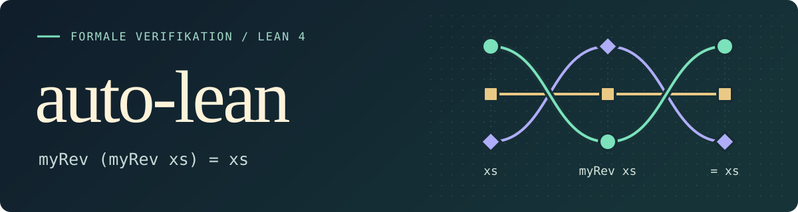

# auto-lean

**Ein Sprachmodell schlägt den Beweis vor. Lean 4 prüft ihn auf deinem Rechner.**
`auto-lean` ist ein Kommandozeilenwerkzeug für Lean-Dateien mit offenen Beweisen
(`sorry`) und für reine Funktionen in Python oder Rust. Ändert das Modell die
Aussage, weist `auto-lean` den Vorschlag zurück. Bleibt ein Beweisziel offen,
bekommt das Modell die genaue Lean-Fehlermeldung für den nächsten Versuch.

[Schnellstart](#schnellstart-ohne-api-schlüssel) · [Beispielausgabe](#beispielausgabe) · [English documentation](README.en.md)

## Schnellstart ohne API-Schlüssel

Das [Listenbeispiel](examples/demo.lean) stellt eine einfache Frage: Kommt beim
zweimaligen Umdrehen **jeder** Liste wieder das Original heraus? Die Funktion
`myRev` ist schon definiert. Nur der Beweis für `myRev (myRev xs) = xs` fehlt.

Du brauchst [Lean 4](https://lean-lang.org/install/) (`lean` im `PATH`) und
[Rust](https://rustup.rs/) ab Version 1.85. Mathlib und ein Lake-Projekt sind
für das Beispiel nicht nötig. Führe im Projektverzeichnis aus:

```sh
cargo install --locked --path .

AUTO_LEAN_MOCK_SCRIPT=tests/fixtures/demo.replay.md \
  auto-lean solve examples/demo.lean --provider mock --out demo.proved.lean
```

Der Mock-Provider liest drei [aufgezeichnete Modellantworten](tests/fixtures/demo.replay.md).
Nur die Antworten kommen aus der Datei; Lean prüft die Beweise bei jedem Lauf neu.

## Beispielausgabe

Auszug aus dem Demolauf mit Lean 4.36.0. `…` markiert ausgelassene Zeilen;
die Laufzeiten können abweichen.

```text
[1/5] asking the model ... reply in 0.0s
      guard  ✗ 1 violation; Lean was not run
               25:2: forbidden token `sorry`: every proof must be complete
[2/5] asking the model ... reply in 0.0s
      guard  ✓ original statements intact, no forbidden tokens
      lean   ✗ 1 error in 0.69s
               32:17 unsolved goals
               …
[3/5] asking the model ... reply in 0.0s
      guard  ✓ original statements intact, no forbidden tokens
      lean   ✓ exit code 0 in 0.75s
      axioms ✓ only standard axioms (propext)

VERIFIED theorem `myRev_myRev` in 3 iterations (4.8s)
```

Im zweiten Versuch fehlt noch ein Hilfssatz: Beim Aneinanderhängen von Listen
spielt die Klammerung keine Rolle. Im dritten Versuch beweist das Modell auch
diesen Satz. Den fertigen Beweis kannst du ohne Modell gegen die ursprüngliche
Aussage prüfen:

```sh
auto-lean verify demo.proved.lean --spec examples/demo.lean
```

## Eigene Dateien prüfen

| Befehl | Wann du ihn brauchst |
| --- | --- |
| `auto-lean solve datei.lean` | Die Aussagen stehen fest; das Modell soll die `sorry`-Lücken schließen. |
| `auto-lean prove-code funktion.rs` | Du möchtest für eine reine Rust- oder Python-Funktion (`.rs`, `.py`) ein Lean-Modell erstellen und Eigenschaften davon beweisen. Mit `--spec-only` kannst du die Übersetzung zuerst lesen. |
| `auto-lean verify beweis.lean --spec datei.lean` | Du hast bereits einen Beweis und möchtest Aussagen und Axiome ohne Modell prüfen. `--json` liefert den Bericht für Skripte. |

Für neue Beweisvorschläge nutzt `solve` standardmäßig Anthropic
(`ANTHROPIC_API_KEY`). Alternativ unterstützt das Werkzeug OpenAI,
OpenAI-kompatible lokale Server und Microsoft Foundry.
[Provider und Umgebungsvariablen →](README.en.md#environment-variables)

**Was bedeutet `VERIFIED` bei Rust oder Python?** Lean hat die angegebenen
Eigenschaften des **Lean-Modells** bewiesen. Ob dieses Modell den Quellcode
richtig übersetzt und die gewünschte Eigenschaft beschreibt, musst du prüfen.
`NOT VERIFIED` bedeutet dagegen nur, dass in den erlaubten Versuchen kein
Beweis gelang – nicht, dass die Aussage falsch ist.

Ein Beispiel dafür, warum die Typen zählen: In der [Rust-Mittelwertfunktion](examples/midpoint_bug.rs)
läuft bei `lo = hi = 2³¹` die Summe `(lo + hi)` im `UInt32`-Modell auf `0` über.
Der berechnete Mittelwert liegt damit unter `lo`. Die
[korrigierte Fassung](examples/midpoint_fixed.rs) verwendet `lo + (hi - lo) / 2`;
für `lo ≤ hi` bleibt das Ergebnis zwischen den beiden Grenzen.
